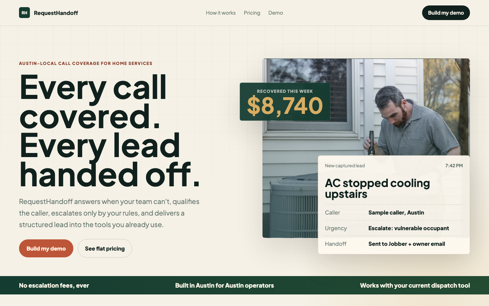
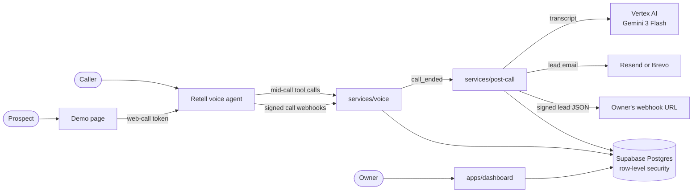

# RequestHandoff

RequestHandoff answers the calls a small home-service business misses, takes down the job, and sends a structured lead to the tools the owner already uses.



## The problem

Most HVAC, plumbing, and other home-service shops with 1 to 10 people have no front desk, so calls that come in during a job, at night, or on the weekend go to voicemail. Industry figures cited in [`STRATEGY.md`](./STRATEGY.md) put the loss at 27–40% of inbound calls, and 85% of those callers phone the next company instead of leaving a message. The AI receptionists already on the market tend to charge per escalation or want the owner to move onto their CRM.

## What I built

Everything in this list exists in the repo. The services and shared packages have unit tests, and the dashboard pages don't.

- The voice service (`services/voice`) is a Hono app with four tools the agent calls during a live conversation: `check_hours`, `check_service_area`, `request_schedule_window` and `escalate_now`. Tenant config is cached in memory so repeat tool calls skip the database, and Retell webhooks are HMAC-verified before anything gets written.
- Urgency rules are composed per business in `services/voice/src/runtime/playbook.ts`. Every business starts with a life-safety baseline (fire, gas, flooding, medical emergencies), then gets its vertical's rules (General or HVAC), then any rules the owner adds. An owner rule can't override a life-safety rule, and `escalate_now` refuses to escalate when nothing matches.
- After a call ends, the post-call worker (`services/post-call`) has Gemini 3 Flash turn the transcript into a lead, which must pass a zod schema. If it fails, the worker retries once with a corrective prompt. A second failure goes to manual review.
- Leads go out by email through Resend or Brevo, with up to five attempts. Owners can also add a webhook URL for Zapier, Make, or n8n. That path only accepts HTTPS, rejects private and loopback addresses, and signs every payload with HMAC-SHA256, and the signing secret is stored encrypted with AES-256-GCM.
- The owner dashboard (`apps/dashboard`, Next.js 15) has magic-link login, a lead list and lead detail, a status field with a dollar value for booked jobs, an escalation log with a "Wasn't actually urgent" button, a usage page, and webhook settings with a test send.
- A public demo page (`/demo/[demoId]`) lets a prospect talk to a demo agent in the browser. Before the server asks Retell for a call token, it checks Cloudflare Turnstile, a limit of one session per IP per hour, a session cap per demo, an expiry date, and a monthly spend budget.
- The Postgres schema in `supabase/` has 11 tables, and row-level security is on for the 10 that hold tenant data. An ESLint rule keeps the service-role client, which bypasses that security, out of everything except the services and the admin routes.
- There are 137 Vitest tests in 15 files. CI runs typecheck, lint, test, and build on every pull request.

**Planned but not built yet:** Jobber delivery, the weekly ROI email, Sentry alerts, and Stripe billing. The founder-only website extractor has a UI and an access-checked route, but the route still returns a placeholder draft.

## Architecture



## Product decisions

### Hand leads to the tools the owner already uses

`STRATEGY.md` calls integration-neutral handoff "the meaning of the name." It's also the gap Avoca and ServiceTitan won't close, because "they want to *be* the dispatch system." For the MVP, that meant shipping a generic signed webhook before a native Zapier app. The plan put it as "90% of the value (lead JSON delivered to any destination) for 5% of the build."

### Charge one flat monthly price with no escalation fees

The tiers are $79, $179, and $349 a month. `STRATEGY.md` names "Smith.ai's $4.25-per-escalation surcharge and AnswerConnect's opaque per-minute model" as the loudest complaints in the category, so a predictable bill is the trust promise.

### Start in Austin with two playbooks

`GTM-PLAYBOOK.md` picked Austin for its "triple seasonality." Summer heat hits HVAC, freezes hit plumbers, and spring hail hits roofers, which gives three "I missed a $4k job" moments a year where Phoenix has one. The MVP ships a General playbook and an HVAC playbook. The plan's math was that two would cost "~30% more upfront work than HVAC-only, but ~10× more addressable prospects with a graceful default."

## Status

MVP in progress, with a public site at [requesthandoff.com](https://requesthandoff.com). In June 2026 a hosted readiness check passed: the demo page issued a live call token, and synthetic calls went from the voice webhook through extraction to a delivered email ([readiness plan](./docs/plans/2026-06-06-founder-led-demo-readiness-finalization-plan.md)). RequestHandoff hasn't yet completed a conversation with an Austin home-service owner, so the [current plan](./docs/plans/2026-07-23-001-first-design-partner-evidence-sprint.md) puts customer evidence ahead of new features.

## About

Built by Krish Puvvada, AI product leader. More at [krishpuvvada.com](https://krishpuvvada.com).

I build RequestHandoff on my own time, with Claude Code as my pair. This is a public snapshot of a private working repo. Prospect research and outreach lists are left out, and personal contact details are replaced.

---

## Run it

You need Node 20.11 or later and pnpm 9. The tests use fakes, so you don't need any accounts or keys.

```bash
pnpm install
pnpm build
pnpm test
```

`pnpm test` runs 137 tests in 15 files across five workspaces: voice (48), post-call (45), outbound-webhook (18), dashboard (14), and schema (12). `pnpm typecheck` and `pnpm lint` also pass.

This command sends one signed Retell `call_ended` payload through the voice webhook and the post-call worker, using in-memory storage, and prints the call, lead, delivery, and telemetry records it produced:

```bash
pnpm fixture:call-ended
```

### Running against real services

```bash
cp apps/dashboard/.env.example apps/dashboard/.env.local
cp services/voice/.env.example services/voice/.env
cp services/post-call/.env.example services/post-call/.env
```

For a local end-to-end webhook test, set the same `POST_CALL_WEBHOOK_SECRET` in `services/voice/.env` and `services/post-call/.env`, then point `POST_CALL_WORKER_URL` in `services/voice/.env` at the post-call worker (`http://localhost:8081` by default).

To work in one workspace:

```bash
pnpm --filter @requesthandoff/dashboard dev
pnpm --filter @requesthandoff/voice dev
pnpm --filter @requesthandoff/schema test
```

The Supabase-backed fixture writes real `calls`, `leads`, and `deliveries` rows and then cleans them up. It refuses to run against a Supabase URL that isn't local.

```bash
SUPABASE_URL=http://127.0.0.1:54321 \
SUPABASE_SERVICE_ROLE_KEY=<local service-role key> \
pnpm fixture:call-ended:supabase
```

Local Supabase needs the Supabase CLI and Docker:

```bash
supabase start
supabase migration up
supabase db reset
```

Once the services are deployed, this checks the hosted setup end to end:

```bash
pnpm demo:readiness
```

The commands above have no inline `#` comments, so they paste cleanly into zsh or bash.

## Stack

| Layer            | Choice                                                      | Why (from the plan)                                                                 |
| ---------------- | ----------------------------------------------------------- | ----------------------------------------------------------------------------------- |
| Voice runtime    | Retell AI                                                   | Built for inbound business agents. In the voice service, Retell code lives in one file (`runtime/retell.ts`) so the runtime can be swapped later |
| Dashboard        | Next.js 15 (App Router) on Vercel                           | Server components for the lead list, plus Supabase Auth helpers                     |
| Voice service    | Hono on a Render web service                                | Always warm, in the same region as the database                                     |
| Post-call worker | Hono on a Render background worker                          | Handles the slower work: extraction and delivery                                    |
| Database + auth  | Supabase Postgres (us-east-1), Supabase Auth magic link     | Row-level security keyed off `auth.uid()` keeps tenants apart                       |
| Post-call LLM    | Vertex AI Gemini 3 Flash (`gemini-3-flash-preview`, pinned) | Structured output in one call, with the prompt version in the cache key             |
| Email            | Resend or Brevo (`POST_CALL_EMAIL_PROVIDER`)                | Resend is the default                                                               |
| Validation       | zod schemas in `packages/schema`                            | One lead schema shared by extraction, the services, and the dashboard               |
| Build and test   | pnpm + Turborepo, TypeScript, Vitest                        | Monorepo with independent deploys                                                   |

## Repository layout

```
apps/
  dashboard/                  Next.js: marketing pages, owner dashboard, founder admin, demo pages
services/
  voice/                      Hono: Retell webhooks + mid-call tools
  post-call/                  Hono: extraction + delivery
packages/
  schema/                     zod schemas + TypeScript types
  outbound-webhook/           webhook URL validation, signing, secret encryption
  supabase-client-rls/        user-JWT client (RLS enforced)
  supabase-client-service/    service-role client (services and admin routes only)
supabase/
  migrations/                 0000_init.sql
  policies/                   per-table RLS policies
  seed/                       general.sql, hvac.sql playbooks
scripts/                      local call fixture, hosted readiness check
docs/                         plans, brainstorms, design system, operations
```

## Documentation

Read in this order:

1. [`STRATEGY.md`](./STRATEGY.md): problem, approach, customer, metrics, tracks.
2. [`GTM-PLAYBOOK.md`](./GTM-PLAYBOOK.md): beachhead, pricing, competitor battlecard, sales motion.
3. [`docs/brainstorms/requesthandoff-design-requirements.md`](./docs/brainstorms/requesthandoff-design-requirements.md): requirements, acceptance examples, key flows.
4. [`docs/plans/2026-05-04-001-feat-requesthandoff-mvp.md`](./docs/plans/2026-05-04-001-feat-requesthandoff-mvp.md): MVP plan, locked technical decisions, implementation units.
5. [`docs/operations/customer-evidence-gates.md`](./docs/operations/customer-evidence-gates.md): the evidence needed before scope or positioning changes.
6. [`docs/PRD.md`](./docs/PRD.md): long-form spec.

## License

UNLICENSED. All rights reserved.
